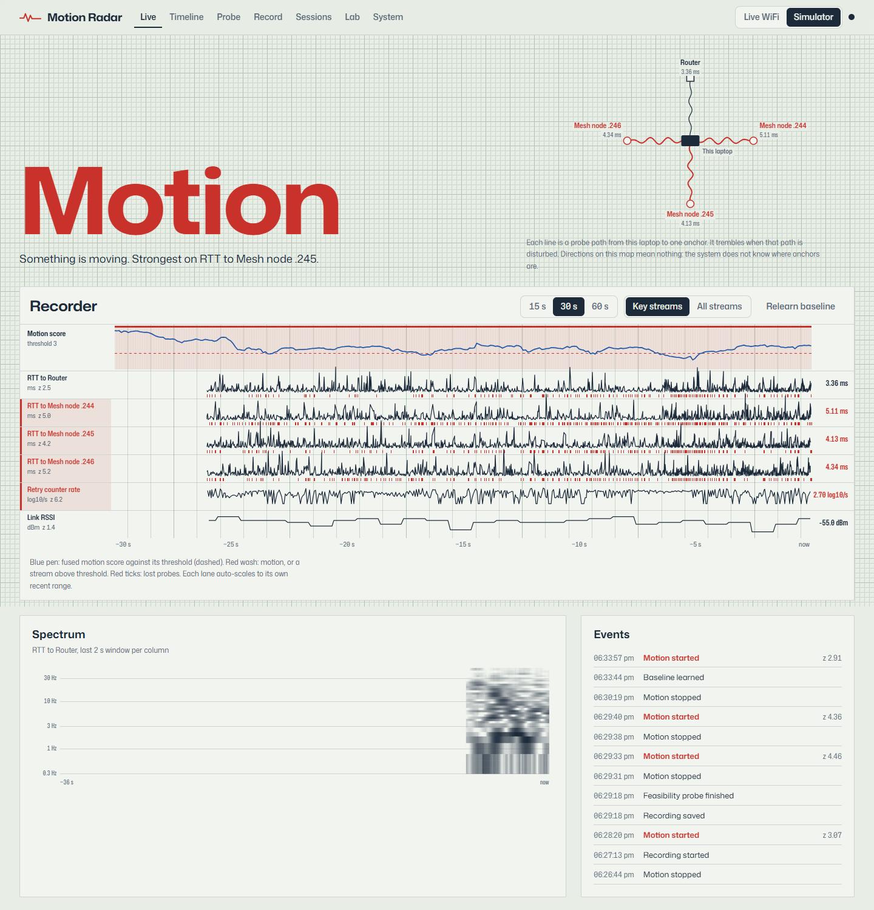
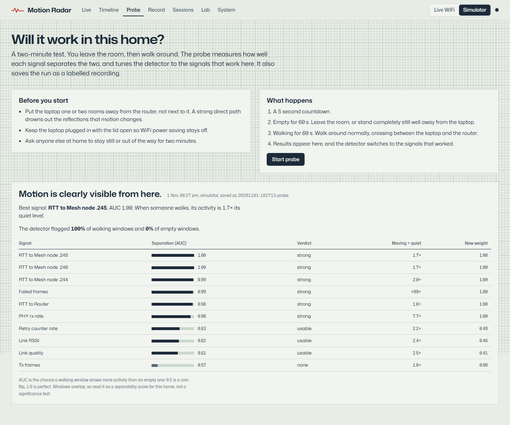

# WiFi Motion Radar

Motion sensing from the WiFi link a laptop already has. No extra hardware: the laptop
times its own round trips to the router and to the mesh nodes around the home, reads its
WiFi driver's counters, and turns the disturbance that a moving person causes into a
live motion signal.



*The live view, running on the simulator (the image shows simulated data). The state word
widens and darkens as the fused motion score rises. Each lane of the chart recorder is
one sensing stream; red in the gutter marks a stream that is disturbed right now.*

## Status

| Part | State |
|---|---|
| Sensing on Windows (link quality, driver counters, 100 Hz probing of 7 anchors) | Working, measured below |
| Feature pipeline, adaptive detector, recording, replay, feasibility probe | Working, 37 tests |
| Dashboard (live, timeline, probe, record, sessions, lab, system) | Working |
| Feasibility test in a real home | **Next.** The probe is built; the run has not happened yet |
| Labelled multi-day dataset, classifier, cross-day evaluation | Planned |

No accuracy figure for a real home appears in this README yet, because none has been
measured. Simulator results are reported separately and labelled as such.

## What it can and cannot do

| Question | Answerable from software alone? |
|---|---|
| Is something moving in the home right now? | Yes, this is the core of the project |
| Has anyone moved in the last N minutes? | Yes |
| Walking versus still | Partly. Walking is visible; a person sitting still is not |
| Which part of the home | Partly. Each probe anchor's path crosses a different area, so the pattern of disturbed paths carries coarse zone information |
| Breathing, gestures, a dot on a floor plan | No. These need channel state information (CSI) from specific hardware |

The floor plan in the dashboard appears only in simulator mode, where it shows the
simulator's ground truth. The detector never sees it.

## What a laptop can actually measure

The original plan assumed WiFi signal strength (RSSI) can be polled at 10 to 50 Hz.
Measuring first showed otherwise. On the development laptop (MediaTek MT7925, Windows 11,
5 GHz):

| Reading | Polled at | Value actually changed | Consequence |
|---|---|---|---|
| RSSI, legacy driver query | 8,400 per second | 0 times in 25 s | Cached by the driver; useless for motion |
| RSSI, Windows 11 link-quality query | 10 to 90 per second | 2 times in 25 s, 0 in 15 s | A slow stream, kept but weighted low |
| ICMP round trip to the router | 100 per second | every sample, 0.1% loss | The primary signal |
| ICMP round trip to each of 6 mesh nodes | 50 per second | every sample, at most 0.3% loss | Spatial diversity without monitor mode |
| Driver retry counter | 20 per second | every sample | Does not follow its documented meaning (see below) |

The driver's "retry" counter rises by about 15,500 per second while the laptop sends 40
frames per second, and its "multiple retry" counter is exactly 10% of "retry" at every
reading. A retry ratio computed from these numbers would be meaningless, so the stream is
the logarithm of the counter's rate, and the feasibility probe decides whether it carries
motion in a given home.

Run `radar rates` to produce the same table for any machine. The System view in the
dashboard shows it live.

## How it works

```
sources (threads)         engine (every 0.1 s)                         dashboard
-----------------         --------------------                         ---------
WLAN driver queries  -->  ring buffers  -->  2 s window per stream
ICMP probers x N     -->                     resample to a uniform grid
simulator / replay   -->                     features + activity
                                             robust z vs quiet baseline
                                             weighted fusion
                                             CUSUM + hysteresis  -->  WebSocket frames
                                             recorder / probe / timeline / guard
```

The choices that matter:

- **Activity is a robust spread, not a standard deviation.** Half the 10th-to-90th
  percentile range of the detrended window. One stray 20 ms ping cannot move it; the
  sustained broadening that motion causes (retransmissions after fades) does.
- **The baseline learns only from quiet windows.** Each stream keeps the median and MAD
  of its activity over roughly the last five minutes of windows that were not motion, so
  it follows slow drift without learning a walking person as normal. Learning is gated at
  the motion threshold rather than the release threshold; a tighter gate keeps only the
  low half of a drifting signal and the baseline falls further behind with every update.
- **Motion starts on either of two triggers.** The fused score staying above threshold
  for three windows catches sudden motion; a CUSUM catches slow, sustained disturbance.
  Motion ends when a 0.5 s smoothed score stays below a lower threshold for three seconds,
  so a single noisy window cannot restart the timer.
- **Stillness is reported honestly.** After motion stops, the state reads "motion stopped
  N minutes ago" rather than "empty". Timing and signal strength cannot see a person who
  is not moving.
- **Probe anchors are found automatically.** The router is always an anchor. Mesh nodes
  and extenders are recognised by sharing the router's vendor prefix; they are
  mains-powered and fixed in place. Phones and laptops are listed but off by default,
  because power saving makes their round trips erratic.

## The feasibility probe



A guided two-minute test: leave the room, then walk around. For each stream it reports
the ROC AUC of walking windows against empty ones, the detector's hit rate and false
alarm rate on the same windows, and it re-weights the detector towards the streams that
worked. The run is saved as a labelled recording. On the simulator the router and mesh
round trips reach AUC 0.98 to 1.00 and the detector flags 100% of walking windows with no
false alarms; whether a real home comes close is the open question.

## The simulator

A 2-D home with three rooms, a router, three mesh nodes and the laptop. A person is a
moving scatterer: each radio hop's channel is the sum of the line-of-sight ray, fourteen
fixed scatterers, and the person's ray, with body shadowing on any path the person
stands in. The fading feeds a rate-adaptation model, so deep fades cause retransmissions
that lengthen round trips, exactly the mechanism the real system relies on. It also
injects one realistic confound: bursts of other household traffic that raise round trips
with nobody moving.

The simulator exists for tests with ground truth and for a demo that runs on any machine.
Its numbers say the pipeline is wired correctly, not that the method works in a real home.

## Run it

Requirements: Python 3.11+, Node 20+, Windows 10/11 for live sensing (any OS runs the
simulator).

```powershell
python -m venv .venv
.venv\Scripts\activate
pip install -e ".[dev]"
npm --prefix web install
npm --prefix web run build

radar serve --open            # live WiFi; falls back to the simulator if unavailable
radar serve --source sim      # simulator only
radar rates                   # measure what this adapter really delivers
radar anchors                 # list probe anchors with a test ping
radar simulate --minutes 10   # write a labelled simulated session
pytest
```

For frontend work, run `radar serve` and `npm --prefix web run dev` together; Vite proxies
the API on port 5173.

Placement matters. With the laptop next to the router, the direct path dominates and
motion changes little. One or two rooms away, with the laptop plugged in so WiFi power
saving stays off, is the starting point the probe recommends.

## How results will be judged

Every claim will be backed by data the model never saw, preferably from a different day.

- Within-session split: reported, but flagged as flattering.
- Leave-one-day-out: the headline number.
- After moving the laptop or router: reported before and after recalibration.
- Baselines the classifier must beat: always predicting empty, and a single variance
  threshold.
- The detector: precision and recall on labelled windows, and false alarms per hour on a
  genuinely empty recording.

## Limits

- A person who is not moving is invisible to round-trip timing and RSSI.
- Round trips also rise when someone else on the network streams video. The probe and the
  false-alarm recording measure how often that fools the detector in a given home.
- Every round trip the laptop measures shares its own first hop, so the laptop's own
  radio behaviour shows up on every anchor at once. On the development laptop, all
  anchors spike together about once a second. Rejecting that common-mode component is
  the next signal-processing step.
- Live sensing is Windows-first. The Linux backend reads `/proc/net/wireless` and is
  tested on captured output; the macOS backend is untested.
- Sensing per-subcarrier channel state (CSI) for breathing or gestures needs specific
  network cards or an ESP32 and is out of scope.

## Privacy

Everything stays on the machine. The server binds to 127.0.0.1 unless started with
`--host`. Recordings store a one-way hash of the access point address, never the address
itself; device MAC addresses stay in a local file and never enter a recording. The
`data/` directory is git-ignored. Test fixtures captured from real hardware have the
network name and address overwritten before they are saved.

## Repository layout

```
radar/
  sources/     Windows WLAN + ICMP backends, anchor discovery, simulator, replay, Linux/macOS
  dsp/         ring buffers, resampling, features, detector
  engine.py    the live loop
  probe.py     feasibility probe scoring
  offline.py   the same pipeline over recorded sessions, for datasets and tests
  occupancy.py timeline, event log, Away Guard
  store/       session recording (Parquet + JSON)
  server/      FastAPI + WebSocket
web/           React + TypeScript dashboard (canvas rendering, no chart library)
tests/         parsers on captured hardware buffers, DSP, detector, simulator, API
scripts/       fixture capture, dashboard screenshots
```
